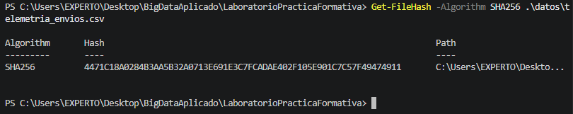
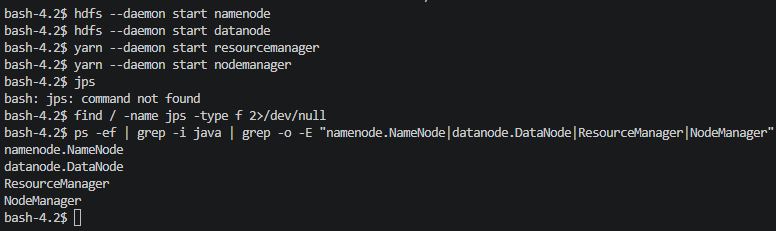
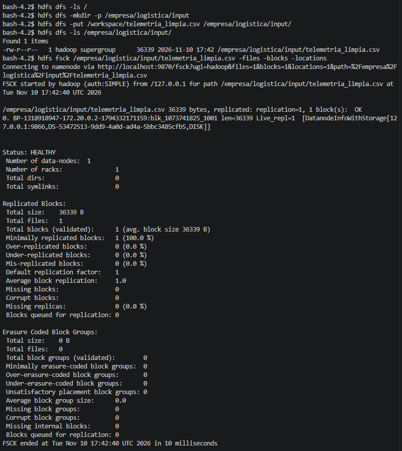

# Práctica Formativa Integradora: Integridad del dato y toma de contacto con HDFS

**Autor:** Antonio
**Fecha:** 10/11/2026
**Módulos:** 5075 (Sistemas de Big Data / integridad) · 5074 (HDFS y almacenamiento distribuido)

Práctica en la que, como analista júnior de datos, se verifica la integridad de un volcado de telemetría logística, se depura y se ingesta en un clúster Hadoop (HDFS) desplegado con Docker para auditar su fragmentación en bloques.

## Estructura del repositorio

```
.
├── README.md
├── docker-compose.yml
├── datos/
│   ├── telemetria_envios.csv      # original
│   └── telemetria_limpia.csv      # saneado
├── scripts/
│   └── calidad_datos.py           # hashes SHA-256 + limpieza
└── evidencias/
    ├── 01_hashes_sha256.png
    ├── 02_jps_servicios.png
    ├── 03_hdfs_comandos_fsck.png
    └── 04_webui_hdfs_browse.png
```

---

## Sección 1. Integridad del dato (Módulo 5075)

### 1.1 Huella criptográfica del fichero original

El hash SHA-256 de `telemetria_envios.csv` coincide con el hash de referencia indicado en el enunciado, lo que confirma que el fichero no se alteró durante la descarga.

| Fichero | Filas | Tamaño | SHA-256 |
|---|---|---|---|
| `telemetria_envios.csv` (original) | 300 | 36 999 bytes | `4471c18a0284b3aa5b32a0713e691e3c7fcadae402f105e901c7c57f49474911` |
| `telemetria_limpia.csv` (saneado) | 292 | 36 339 bytes | `23FE3D0B4801E8D90FE7BD79004F79C74058FA79C6DE0A62D0964CE616F42513` |

Los dos hashes son completamente distintos: al eliminar filas cambia el contenido y, por el efecto avalancha de SHA-256, la huella resultante no guarda ninguna relación con la original.

Comandos usados (PowerShell):

```powershell
Get-FileHash -Algorithm SHA256 .\datos\telemetria_envios.csv
Get-FileHash -Algorithm SHA256 .\datos\telemetria_limpia.csv
```

### 1.2 Control de calidad

El script [`scripts/calidad_datos.py`](scripts/calidad_datos.py) (Python + pandas) lee el original, aplica las reglas de depuración y calcula ambos hashes. Se ejecuta con:

```bash
pip install pandas
python scripts/calidad_datos.py
```

Reglas aplicadas, en orden, y filas eliminadas por cada una:

| # | Regla | Filas eliminadas |
|---|---|---|
| 1 | Eliminar registros duplicados exactos (`ENV-2026-1012` y `ENV-2026-1078`) | 2 |
| 2 | Eliminar filas con nulos en `destino`, `peso_kg` o `temp_celsius` | 3 |
| 3 | Eliminar pesos no positivos (`peso_kg` ≤ 0; había un valor de -45,50 kg) | 1 |
| 4 | Eliminar temperaturas fuera del rango −30 °C a 30 °C (había una lectura de 98,4 °C) | 1 |
| 5 | Eliminar estados no catalogados (`DESCONOCIDO_ERROR`) | 1 |
| | **Total eliminado** | **8** |

**Resultado: 300 filas → 292 filas.**

Decisión de diseño: el estado `INCIDENCIA_REPARTO` (15 registros) se considera **válido**, ya que es un estado operativo legítimo del servicio y no una anomalía. Solo se descartó `DESCONOCIDO_ERROR`.

---

## Sección 2. Despliegue y HDFS (Módulo 5074)

### 2.1 Contenedor Hadoop

Se utiliza la imagen `apache/hadoop:3.4.0` mediante Docker Compose. Puertos mapeados:

| Puerto host | Servicio |
|---|---|
| `9870` | Interfaz web del NameNode (HDFS) |
| `8088` | Interfaz web del ResourceManager (YARN) |

La carpeta local `./datos` se monta en el contenedor como `/workspace`, de modo que el CSV saneado es accesible desde dentro.

### 2.2 Incidencias encontradas y ajustes realizados

El `docker-compose.yml` del enunciado no funcionó tal cual, y fue necesario hacer tres ajustes:

1. **El contenedor se detenía solo (`Exited (127)`).** El código 127 indica «comando no encontrado»: la imagen intentaba ejecutar `standalone` como un programa que no existe. Se sustituyó por `command: ["tail", "-f", "/dev/null"]`, que mantiene el contenedor activo.
2. **Conflicto de nombre de contenedor.** Existía un contenedor `hadoop-lab` anterior; se eliminó con `docker rm -f hadoop-lab` antes de volver a lanzar el compose.
3. **Los demonios de Hadoop no arrancaban por sí solos**, al no existir un proceso de arranque. Se configuraron y se iniciaron manualmente dentro del contenedor:

   `core-site.xml`: `fs.defaultFS = hdfs://localhost:9000`
   `hdfs-site.xml`: `dfs.replication = 1` (solo hay un DataNode)

   ```bash
   hdfs namenode -format -force
   hdfs --daemon start namenode
   hdfs --daemon start datanode
   yarn --daemon start resourcemanager
   yarn --daemon start nodemanager
   ```

### 2.3 Verificación de servicios

La imagen `apache/hadoop:3.4.0` solo incluye el JRE, por lo que el comando `jps` no está disponible. La actividad de los cuatro demonios esenciales se verificó con `ps`:

```bash
ps -ef | grep -i java | grep -o -E "namenode.NameNode|datanode.DataNode|ResourceManager|NodeManager"
```

Resultado: **NameNode, DataNode, ResourceManager y NodeManager** activos (ver evidencia 02).

### 2.4 Comandos HDFS ejecutados

```bash
hdfs dfs -ls /
hdfs dfs -mkdir -p /empresa/logistica/input
hdfs dfs -put /workspace/telemetria_limpia.csv /empresa/logistica/input/
hdfs dfs -ls /empresa/logistica/input/
hdfs fsck /empresa/logistica/input/telemetria_limpia.csv -files -blocks -locations
```

### 2.5 Resultado de la inspección de bloques (`hdfs fsck`)

| Dato | Valor |
|---|---|
| Ruta en HDFS | `/empresa/logistica/input/telemetria_limpia.csv` |
| Tamaño | 36 339 bytes |
| Número de bloques | 1 (el fichero es muy inferior al tamaño de bloque de 128 MB) |
| ID del bloque | `blk_1073741825_1001` |
| Block pool | `BP-1318918947-172.20.0.2-1794332171159` |
| Nodo donde se almacena | DataNode `127.0.0.1:9866` (almacenamiento `DISK`) |
| Replicación | 1 (`Live_repl=1`) |
| Estado | `HEALTHY` · 0 bloques perdidos · 0 corruptos · 1 DataNode · 1 rack |

Se ha comprobado también el fichero desde la interfaz web del NameNode (`http://localhost:9870` → *Utilities → Browse the file system*).

---

## Sección 3. Análisis crítico

**¿Por qué un fichero en HDFS no se corrompe ni se pierde aunque falle o se apague un DataNode en un clúster de producción?**

HDFS no guarda un fichero como una pieza única: lo divide en bloques (de 128 MB por defecto) y **replica cada bloque en varios DataNodes distintos**, normalmente tres. Así, ningún nodo concreto es imprescindible: si uno se apaga o se estropea, siguen existiendo al menos otras dos copias completas de cada uno de sus bloques en otros nodos. En un clúster real, además, la colocación de réplicas tiene en cuenta los *racks*, de forma que las copias no quedan todas en el mismo armario y el sistema resiste incluso la caída de un rack entero.

El NameNode, que mantiene el mapa de qué bloques componen cada fichero y en qué nodos están, supervisa el estado del clúster mediante los *heartbeats* y los informes de bloques que le envía cada DataNode. Si un DataNode deja de enviar señales de vida, el NameNode lo da por caído y detecta que los bloques que alojaba han quedado con menos réplicas de las configuradas (*under-replicated*). Entonces ordena automáticamente copiar esos bloques desde las réplicas supervivientes a otros nodos, hasta restaurar el factor de replicación. Todo esto ocurre sin intervención humana y sin que las aplicaciones que leen el fichero lo noten, porque pueden leer cualquiera de las réplicas disponibles.

Respecto a la corrupción, HDFS almacena **sumas de verificación (checksums) por cada bloque** y las comprueba al leer y de forma periódica en segundo plano. Si una réplica está dañada, se descarta, se sirve la lectura desde una réplica sana y el NameNode programa la creación de una copia nueva correcta. En esta práctica, el factor de replicación es 1 porque solo hay un DataNode (un solo bloque `blk_1073741825`, alojado en un único nodo), por lo que **este laboratorio no dispone de esa tolerancia a fallos**: si ese DataNode se perdiera, el dato se perdería. Es precisamente la replicación sobre varios nodos en producción la que aporta la durabilidad descrita.

---

## Sección 4. Evidencias gráficas

### 01. Hashes SHA-256 antes y después de la depuración


### 02. Servicios Hadoop activos en el contenedor


### 03. Comandos HDFS (`-put`, `-ls`) y análisis de bloques con `fsck`


### 04. Interfaz web del NameNode: explorador de ficheros
